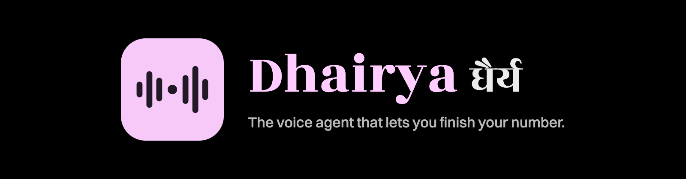

<p align="center">
  
</p>

<p align="center">
  <a href="https://shreytiwari09.github.io/Dhairya/"><b>Open the demo</b></a> ·
  <a href="docs/Dhairya-one-page-pitch.pdf">One-page pitch (PDF)</a> ·
  <a href="results/RESULTS.md">Results</a> ·
  <a href="#live-demo">Live demo</a> ·
  <a href="#how-it-works">How it works</a> ·
  <a href="docs/PROBLEM_SOLVED.md">Problem and research</a>
</p>

<p align="center">
  
  
  
  
  
</p>

Voice agents usually decide a caller has finished after a fixed stretch of silence, and people pause while reading out a mobile number, an OTP, an amount or a date. Dhairya is a turn-taking layer on Gnani's Prisma v3.0 realtime speech-to-text: it tracks the value being dictated, waits while the value is incomplete, and answers at once when it is complete. On 152 held-out synthetic Hinglish calls it interrupted none of them and captured the right value in 99%, with a median wait of 0.42 s; a 1000 ms silence timer interrupted 24%, and the 2000 ms timer that also interrupted none waited 2.22 s.


## Built with

| Layer | Technology | Used for |
|---|---|---|
| Speech to text | **Gnani Prisma v3.0**, realtime WebSocket and REST | Streams the caller's audio; a second pass checks the whole turn |
| Text to speech | **Gnani Timbre v2.5** | The synthetic callers in the benchmark, and the agent's prompts and read-back |
| Core | Python 3.11, `numpy`, `httpx`, `websockets` | Turn policies, the Hindi and English number parser, the slots, the live loop |
| Live demo server | FastAPI, uvicorn | Takes a visitor's microphone over a WebSocket; limits, origin check, audio links |
| Benchmark | `pytest`, `ruff`, `uv`, `ffmpeg` | 152 offline tests, 200 synthetic calls, replayed over saved traces |
| Baseline | Smart Turn v3.2 (Pipecat, BSD-2-Clause), ONNX Runtime | An outside open model, run locally for comparison only |
| Demo page | Plain HTML, CSS and JavaScript, GSAP, ScrollTrigger, Lenis | Replays recorded calls, the hold-to-pause demo, the live call, the results |
| Type | Gilda Display, Rozha One, Switzer, Anek Devanagari | Headings, the Dhairya wordmark, body text, Hindi |
| Hosting | GitHub Pages, Render (free), Docker | The page, and the live agent |

## Result

Held-out calls: the policy was frozen before these 152 calls were recorded. One parser rule was added afterwards, from a live microphone test (see the API findings); re-scoring left every figure below unchanged. Fixed timers are live runs, each with Prisma's own silence window set to the timer value. Dhairya's row is computed from one recording per call at a 200 ms window.

| Policy | Interrupted the caller | Value right | Typical wait (P50) | Slow waits (P95) |
|---|---|---|---|---|
| Fixed timer 300 ms | 75% | 25% | 0.49 s | 0.57 s |
| Fixed timer 500 ms | 62% | 36% | 0.75 s | 1.04 s |
| Fixed timer 700 ms | 49% | 50% | 0.90 s | 1.27 s |
| Fixed timer 1000 ms | 24% | 70% | 1.19 s | 1.78 s |
| Fixed timer 1500 ms | 0% | 99% | 1.73 s | 1.99 s |
| Fixed timer 2000 ms | 0% | 99% | 2.22 s | 2.64 s |
| Smart Turn v3.2 † | 58% | 41% | 0.53 s | 3.27 s |
| **Dhairya** | 0% | 99% | 0.42 s | 1.45 s |

† Smart Turn is not tested fairly here. Each breath group of a synthetic caller is generated separately, so every group ends with sentence-final intonation, which is what Smart Turn listens for. Do not read the 58% as its performance on natural speech. A fair comparison needs natural-prosody audio, which this repository does not yet have.

"Interrupted the caller" means the policy ended the turn before the caller's last sample. "Value right" means the value held at the decision equals the script's value. Wait is measured from the caller's last sample to the decision, for turns that were not interrupted.

The two timers that never interrupt also make the caller wait 1.7 to 2.2 s at the median. Dhairya gets the same 99% value-right with a 0.42 s median wait. Its 0% interruption has a 95% interval of 0 to 2% over 152 calls. It sent one nudge, on one date call that stayed incomplete.

`results/RESULTS.md` has the 95% intervals, the tables for each category (mobile, OTP, amount, date), the development calls, and the list of Dhairya's misses.

### On a phone line

The same 152 held-out calls were resampled to 8 kHz, passed through G.711 mu-law (what a telephone line delivers) and streamed to Prisma with `x-sample-rate: 8000`. The fixed timers are live runs at their own window.

| Policy | Interrupted the caller | Value right | Typical wait (P50) | Slow waits (P95) |
|---|---|---|---|---|
| Fixed timer 500 ms | 64% | 35% | 0.72 s | 1.19 s |
| Fixed timer 1500 ms | 0% | 97% | 1.73 s | 1.99 s |
| **Dhairya** | 0% | 98% | 0.36 s | 1.58 s |

Phone audio cost Dhairya two more wrong values out of 152 (a dropped leading digit and a misheard amount) and no interruptions. No noise was added; this is a clean line at phone bandwidth.

## Live demo

The demo page can also take a visitor's own voice. The browser streams the microphone to a small server (`src/dhairya/web/server.py`), which runs the same live loop as the command line against Gnani and sends back what it hears, what Dhairya decides, and the same call replayed through the six fixed timers, so a visitor sees which timer would have cut them off.

The public demo's live agent runs on Render's free plan at https://dhairya-live.onrender.com, and keeps itself awake by pinging its own address every 8 minutes, so it does not idle. After a restart or a new deploy the first call can take about 30 seconds. Open it from the demo page, under "Try it yourself".

The server holds the Gnani key, so it limits use. Defaults, all set by environment variables: 15 turns per visitor per hour, 40 per visitor per day, 3 callers at once, 400 turns a day in total, and only the demo page's own origin may connect. When Gnani reports no credits the server pauses live mode by itself, and the recorded calls on the page keep working. Audio is sent to Gnani Prisma to be transcribed and is not stored by this server.

Run it locally with your key in `.env`, then open http://localhost:8000:

```bash
uv run uvicorn dhairya.web.server:app --port 8000
```

Deploy it free on Render: New, Blueprint, pick this repository (`render.yaml` and the `Dockerfile` are ready), and paste `GNANI_API_KEY` when asked. Then put the service's address in `demo/config.js` (`window.DHAIRYA_LIVE`) and set the repository variable `LIVE_URL` to the same address, which lets `.github/workflows/keepalive.yml` ping it every 10 minutes so the free service does not sleep. Without a live address the page shows the recorded calls only.

## How it works

The live loop, as `src/dhairya/agent/session.py` runs it:

1. The agent asks for a value in Hindi and streams the caller's audio to Prisma v3.0 realtime at a 200 ms silence window, `verbatim` format.
2. Each finished segment's text is added to everything heard so far in the turn.
3. The expected slot reads that text and reports incomplete, open or complete.
4. Incomplete: wait. Open (valid, but may continue): wait a short grace period. Complete: answer now. New speech cancels any pending end.
5. If nothing new arrives for 4 s while the value is incomplete, the agent nudges the caller ("go on"). It nudges at most twice.
6. When the turn closes, the whole turn goes through Prisma REST in Transcribe mode as a second pass.
7. Timbre reads the value back. If the stream and the second pass agree, the agent asks "is that right?". If they differ, it says what it heard and asks the caller to confirm.

| Slot | Complete when |
|---|---|
| Mobile | 10 digits are heard. A leading 91 or 0 prefix is skipped. A number that starts 91 is held open briefly, in case the 91 is a country code. |
| OTP or PIN | The expected number of digits (4 or 6) is heard. |
| Amount | A unit word such as "rupaye" follows the number. Without one the amount is open: a 600 ms grace, or 1500 ms if the form usually continues ("nau hazaar"). |
| Date | A day and a month are heard, or a relative day, or a numeric date such as 23/6. |

The number parser reads Hindi and English number words in Devanagari and Latin script, plain digits and Devanagari digits, digit by digit or in pairs, "double" and "triple", lakh and crore, and the forms dedh, dhai, sadhe, sava and paune.

The agent degrades in order. A policy error falls back to a fixed 1000 ms timer. A failed second pass uses the streamed value and asks the caller to confirm. A failed speech synthesis shows the text.

## Gnani models and why each setting

| Feature | How it is used | Why |
|---|---|---|
| Prisma v3.0 realtime WebSocket | Carries the caller's audio. Finished segments drive the policy. | In the probe it heard 10 of 10 numbers correctly, and text arrived a median 0.39 s after the pause began. |
| `x-min-silence-ms: 200` | The server's silence window for segmenting speech. | Smallest window tried. Text arrived 0.396 s after the pause, against 0.488 s at 300 ms and 0.738 s at 500 ms. Shorter than this was not tried, because very short segments lose accuracy. |
| Event stream | `speech_start` cancels a pending end. Finished `transcript` events carry the text. | The policy needs only these two. `speech_start` carries `t_ms`, and `transcript` carries `audio_duration_ms` and server `latency` of 35 to 140 ms. |
| `commit` frame | Tested in the probe, not used by the live loop. | It works: with the server window at 2000 ms, text arrived 0.449 s into the pause. |
| Output format `verbatim` on the stream | Segments are read by the number parser. | The stream returns number words for fluent speech and digits for isolated words. The parser handles both, so raw text is never compared. |
| Prisma REST, Transcribe mode | Second pass over the whole turn. | It returns digits. It takes about 0.75 s round trip (median in the probe), too slow to trigger the turn end but fine for a check. On the 200 calls it read the right value in 196 (98%). |
| Timbre v2.5 | Synthetic callers for the benchmark, and the agent's prompts and read-back. | v2.5 reads a group of digits fluently. Timbre v3.0 voices did not (see below). |

Evon is not used. It is not on the API.

## What we learned about the API

These differ from, or add to, Gnani's documentation. Each was found by the probe or by the benchmark.

- The realtime stream takes exactly one language. `hi-IN,en-IN` is rejected with close code 1008. Hindi mode still transcribes English digits and words. REST accepts the comma list.
- Partial results exist. The undocumented header `x-partials: true` makes the server send `partial_transcript` events. They lag by about 1 s and are sometimes wrong (one of five probe calls showed a wrong partial), so Dhairya does not use them.
- Timbre v3.0 voices read Devanagari digit words with 0.3 to 0.5 s gaps. Each digit becomes its own segment, and one-word segments get mis-transcribed ("छह" came back as "थे"). A v2.5 voice does not do this.
- Very short segments lose accuracy. Keep groups fluent and do not shorten the window to chase speed.
- Three digits read together can come back as one number word: "eight nine five" arrived as "आठ सौ पिचानवे". The parser now reads that as three digits. This was found in the first live microphone turn, after the held-out set was recorded. Re-scoring left every held-out figure unchanged.
- English digits spoken in a Hindi-mode stream come back transliterated ("नाइन एट", "थ्री एट"). The lexicon covers these.
- Replaying a fixed timer from a 200 ms recording is harsher than running it live when a pause is exactly as long as the timer. At 1000 ms, 33% were interrupted in the replay and 24% live. So the timer rows above are live runs.

## Try it

```bash
uv sync
uv run pytest
```

The tests need no network and no API key.

Replay demo, published at https://shreytiwari09.github.io/Dhairya/ on every push to `main`. It reads saved results and traces and needs no API key. To run it locally:

```bash
python3 -m http.server 8765 --directory demo
```

Then open http://localhost:8765.

Live agent. It needs `GNANI_API_KEY` in `.env` (copy `.env.example`):

```bash
uv run python -m dhairya.agent.session --slot mobile
uv run python -m dhairya.agent.session --slot mobile --file call.wav
```

The first form listens on the microphone and speaks aloud. The second feeds a 16 kHz mono WAV through the same live loop at real-time pace. `--slot` also takes `otp4`, `otp6`, `amount` and `date`.

## Reproduce the benchmark

Steps marked "credits" call Gnani and spend credits. Every Gnani response is cached on disk, and the recorder is resumable: a finished call is never recorded again.

```bash
uv run python -m dhairya.bench.scripts --seed 7      # generate the 200 scripts, local
uv run python -m dhairya.bench.render                # Timbre clips and spliced audio, credits
uv run python -m dhairya.bench.record                # play audio through Prisma at 200 ms, credits, real-time pace
uv run python -m dhairya.bench.record --window 500   # live fixed-timer run, credits; repeat for 300, 700, 1000, 1500, 2000
uv run python -m dhairya.bench.record --condition phone8k --window 200   # phone-line condition; also --window 500 and 1500 (spends credits)
uv run python -m dhairya.bench.smart_turn_scores     # Smart Turn on every recorded pause, local, free; downloads the 8 MB model to models/ on first run
uv run python -m dhairya.bench.report                # re-score and write results/RESULTS.md, offline, free
```

`uv run python scripts/probe.py` re-runs the API probe that wrote `results/PROBE.md`. It also spends credits.

## Repository layout

```
src/dhairya/
  config.py     environment variables and constants; the only place that reads the environment
  gnani/        the only code that talks to Gnani: realtime stream, REST, speech synthesis, cache, errors
  entities/     number parser, Hindi-English lexicon, the four slots, spoken read-back
  turn/         turn policies: fixed timer, Smart Turn, Dhairya; the replay driver
  agent/        session.py, the live loop
  bench/        scripts, render, record, replay, metrics, report
  demo/         exports the benchmark into the demo page's data file
  web/          the live demo server: limits, audio framing, the fixed-timer replay
demo/           the replay page: static HTML, CSS and JavaScript (vendored GSAP, ScrollTrigger and Lenis in demo/vendor)
scripts/        probe.py, and small Node scripts that screenshot and click through the demo page
docs/           PROBLEM_SOLVED.md (the problem, the research, the method) and the one-page pitch PDF
Dockerfile      the live demo server, for a free host (render.yaml is the Render blueprint)
data/           scripts, audio, recorded traces (cache is git-ignored)
results/        PROBE.md, RESULTS.md, scores.csv
tests/          unit tests, no network
```

Two rules hold the design together. Policies in `turn/` are pure: they take events and return a decision, so the same code runs live and over saved traces. Only `gnani/` talks to Gnani.

## Limits

- The callers are synthetic. Pauses between groups are 0.4, 0.6, 0.8, 1.0 or 1.3 s, chosen by the builder and drawn at random per script. Real callers pause differently.
- Timbre generates the speech that Prisma transcribes, so the test is partly circular.
- Dhairya's row is computed from recorded stream events, not from a live conversation. The live agent runs the same policy code in real time.
- The agent is told which kind of value to expect, as an agent that asked the question would know. Without that, the policy is a fixed timer.
- Open-ended amounts still fall back on a silence timer (a 600 ms grace, or 1500 ms for forms that usually continue). A grace period is a timer with better aim.
- Only Hindi–English is measured. Other languages are not.
- The first 12 scripts of each category were used to tune the amount rule and one misheard-word rule. They are reported separately as development calls. The 152 held-out calls are the result to quote.
- The Smart Turn comparison needs natural-prosody audio to be fair. Human clips are not yet in the benchmark.
- Microphone mode has been tried only a few times.
- The layer sees text only after a segment finishes. It cannot react mid-word.
- No paired test between policies has been run. Intervals are Wilson 95% intervals on each row.
- Not tested: background noise, codecs other than G.711 mu-law, and the hybrid policy.
- Nothing here is a claim about Gnani's internal systems, which are not public.

Dhairya does not claim to have invented semantic turn detection. LiveKit, Pipecat (Smart Turn), AssemblyAI, Deepgram and Telnyx have forms of it. The claim here is narrow: number dictation in Hindi–English on Gnani's stack, measured against fixed timers run live and against Smart Turn.

## Outside models and data

- Smart Turn v3.2, from Pipecat, BSD-2-Clause. It runs locally and is used only as a baseline. Dhairya itself does not call it.
- All callers, numbers, amounts and dates are synthetic, from a seeded generator. There are no real phone numbers and no recordings of real calls.

## Credits and licences

- Code: MIT, see `LICENSE`.
- Demo page: GSAP and ScrollTrigger (GreenSock standard licence), Lenis (MIT). Fonts: Gilda Display, Rozha One and Anek Devanagari (SIL OFL, self-hosted in `demo/fonts`); Switzer is loaded from Fontshare under its own licence. The card artwork and the logo are original.
- The page's look and motion take their technique, not their artwork or fonts, from grail-app.com.

## Context

Built for Gnani AI's Great Indian AI Internship Challenge. A solo build from BML Munjal University, Kapriwas.
